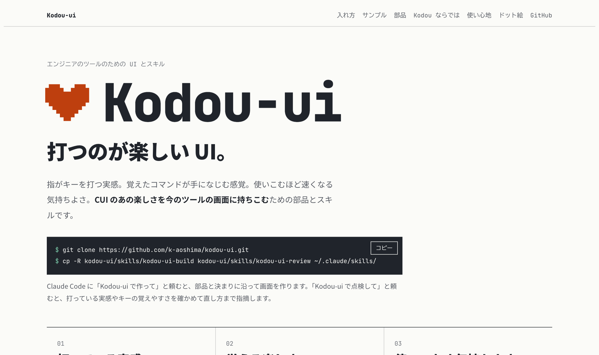
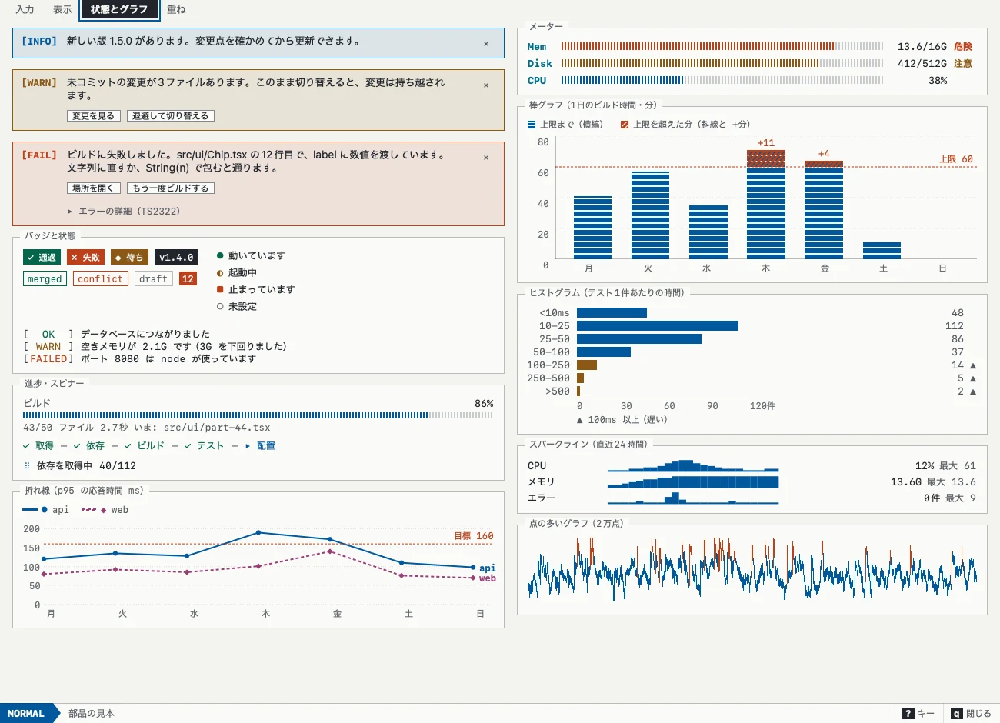

# Kodou-ui

A UI and UX design system for the tools engineers use every day. It keeps the feel of the CLI and brings the look and clarity up to date.

[Site](https://k-aoshima.github.io/kodou-ui/) · [Catalog](https://k-aoshima.github.io/kodou-ui/catalog/) · [UI design course (Japanese)](https://k-aoshima.github.io/kodou-ui/learn/) · [日本語](README.md)



> Status: 0.4.0. The docs and skills are written in Japanese first. Agents read them fine; this page is the English entry point.

## Idea

The form stays retro: a monospace grid, ruled boxes, reverse video for selection, a status line, `[y/N]`, pixel-grid icons. The substance is modern: crisp rendering, 4.5:1 contrast, a proportional typeface for prose, short motion, mouse support, and never color alone. No CRT scanlines or glow.

Every decision is checked against four principles:

1. **Feedback**: every input gets a visible response. Filter on every keystroke. Key to paint within 16 ms.
2. **Visible internals**: show what the machine understood and what it will do, with real values. No bare "Processing…". Show only the values people act on; fold the rest away.
3. **The human holds the wheel**: the machine suggests, a person confirms with one key. Nothing runs on its own by default.
4. **Skill pays off**: usable with a mouse on day one, fewer keystrokes as you learn. Same input, same order of results.

Components alone let you build screens without any of this. So Kodou-ui ships the judgment as agent skills: one that builds, one that reviews, plus scripts that measure.

On the same screen built with React (MUI and Recharts, with the usual optimizations), page memory was 57 MB against 128 MB. See [bench/README.md](bench/README.md).

The same 36 components also exist for native macOS apps in Swift (SwiftUI and AppKit), in [swift/](swift/README.md). Against the same screen in SwiftUI with the usual optimizations (List and downsampled Swift Charts), memory was 34 MB against 112 MB and CPU while streaming was 7.3% against 37.1%. See [bench/swift/README.md](bench/swift/README.md).



## Install

Claude Code:

```
/plugin marketplace add k-aoshima/kodou-ui
/plugin install kodou-ui@kodou-ui
```

Other agents (Codex, Cursor, and others that read [Agent Skills](https://agentskills.io/)):

```sh
npx skills add k-aoshima/kodou-ui
```

Or copy `skills/kodou-ui-build` and `skills/kodou-ui-review` into your agent's skills folder. Install both; the build skill uses the review scripts. The skills carry the components themselves: one HTML file per component (markup, CSS, JS) and 110 pixel icons, extracted from the catalog, so the agent copies working code instead of rewriting it. The Swift components (`KodouUI`) are in the skill too, at `skills/kodou-ui-build/assets/swift/KodouUI/`.

To use them in your own macOS app, copy that folder into your project and add it to your build target. Steps are in [references/swift.md](skills/kodou-ui-build/references/swift.md) (Japanese). Only the swiftc build has been verified so far; SwiftPM and Xcode have not been tried.

## Use

Ask the agent to "build this with Kodou-ui" or "review this with Kodou-ui". For a macOS app, add "in SwiftUI" and it uses the Swift components and the rules for splitting work between SwiftUI and AppKit. After its findings, the review skill also gives you a short script for testing the screen with 3 to 5 real people: tasks written as goals, watch without helping, fix where two or more people get stuck.

Put a `DESIGN.md` at your project root and the build skill reads it first; a template in the [DESIGN.md](https://github.com/google-labs-code/design.md) format is at `skills/kodou-ui-build/assets/DESIGN.md`.

## Checks without an agent

```sh
S=skills/kodou-ui-review/scripts
python3 $S/check.py page.html src/   # contrast, icons and rule detection in one run; exit 0 pass, 1 fail, 2 error
python3 $S/lint.py --rules           # list the detection rules (confirm(), bare "Processing…", Search buttons, left accent bars, hidden focus, ...)
python3 $S/lint.py Sources/          # Swift: timers that keep running when the window is hidden, bulk rows passed to List, text under 12pt, hard-coded colors
node $S/measure.mjs page.html        # element count, JS heap, CPU while hidden (needs puppeteer-core and Chrome)
```

The Python scripts use only the standard library.

## License

MIT. See [LICENSE](LICENSE).
