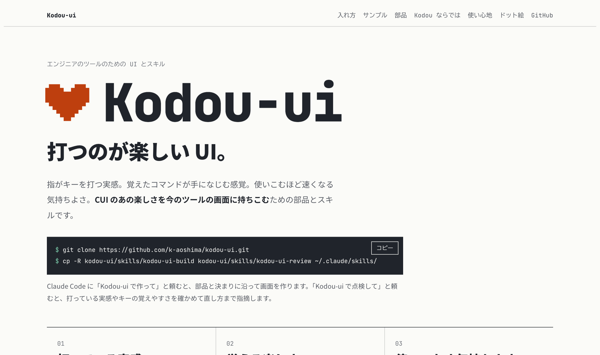
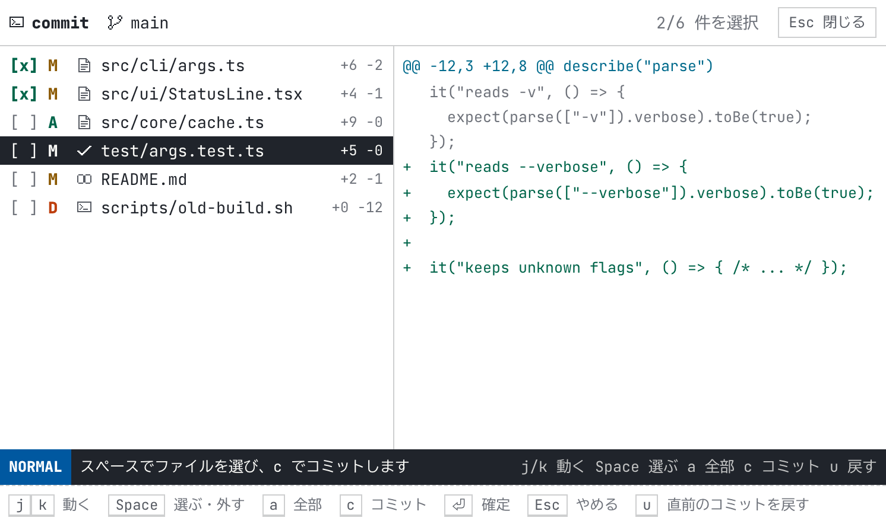
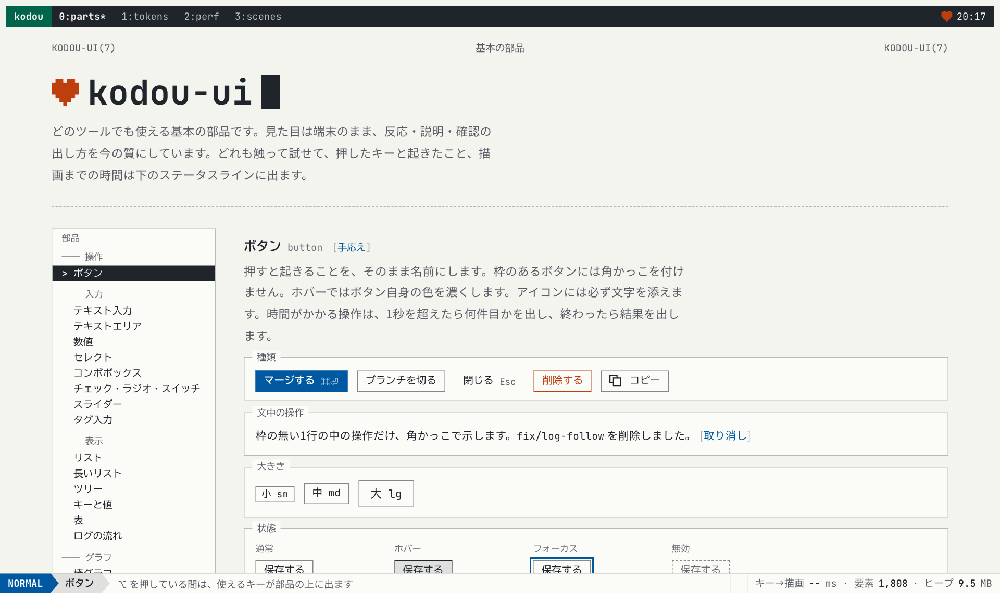

# Kodou-ui

エンジニアが毎日使うツールのための、UI と UX のデザインシステム。CLI の手触りを残したまま、分かりやすさを今のものにする。

[紹介ページ](https://k-aoshima.github.io/kodou-ui/) ・ [見本帳](https://k-aoshima.github.io/kodou-ui/catalog/) ・ [English](README.en.md)



> 状態: 0.4.0。作るスキルと点検するスキルがあり、36 の部品の作りと 110 個のアイコンはスキルの中に入っています。macOS のネイティブ（SwiftUI・AppKit）向けにも、同じ 36 の部品があります。npm のパッケージとしての配布はまだです。変わったことは [CHANGELOG.md](CHANGELOG.md) に書きます。

## 考え方

旧車の車体と手触りを残し、中身を今の技術に載せ替える「レストモッド」という改造があります。Kodou-ui は同じことをツールの UI でします。

今のエンジニアのツールは2つに分かれています。CLI（git、grep、fzf、Vim）は打てば必ず応え、使うほどうまくなりますが、何ができるのか分かりにくく状態も見えにくいツールです。GUI（IDE、Web のダッシュボード、AI のエージェント画面）は分かりやすい一方で、待たされ、中を隠し、AI が勝手に進めます。Kodou-ui は、CLI の手触りを持った今のツールを作るための部品と判断の基準をそろえます。

大事にするのは**操作するよろこび**と**機械との対話**です。詳しくは [docs/principles.md](docs/principles.md) にあります。

部品だけでは、手応えも中の見え方もない画面を組めてしまいます。そのため Kodou-ui は、部品と一緒に作る手順と点検の基準をスキルとしてエージェントに渡します。

## 作れる画面

紹介ページのサンプルで、変更したファイルを選んでコミットする小さなツールです。キーだけで最後まで動きます。



36 の基本部品は見本帳で触って試せます。



同じ画面を React（MUI と Recharts、よく勧められる手当てをしたもの）で作って比べると、ページの使用メモリは 128 MB に対して 57 MB、JS のヒープは 15 分の 1 でした。測り方と結果は [bench/README.md](bench/README.md) にあります。

macOS のネイティブ（SwiftUI・AppKit）向けにも、同じ 36 の部品を Swift で作りました（[swift/](swift/README.md)）。同じ画面を手当てをした SwiftUI（List と間引いた Swift Charts）で作って比べると、メモリは 112 MB に対して 34 MB、流している間の CPU は 37.1% に対して 7.3% でした。測り方と結果は [bench/swift/README.md](bench/swift/README.md) にあります。

## 入れ方

### Claude Code（プラグイン）

```
/plugin marketplace add k-aoshima/kodou-ui
/plugin install kodou-ui@kodou-ui
```

作るスキル（`kodou-ui:kodou-ui-build`）と点検するスキル（`kodou-ui:kodou-ui-review`）が一緒に入ります。

### ほかのエージェント（Codex、Cursor など）

スキルは [Agent Skills](https://agentskills.io/) の形（`SKILL.md` を含むフォルダ）で書いてあります。[skills](https://github.com/vercel-labs/skills) の CLI を使うと、エージェントを選んで入れられます。

```sh
npx skills add k-aoshima/kodou-ui
```

### 手で置く

`SKILL.md` を含むフォルダを、エージェントのスキルのフォルダに写します。Claude Code では次のとおりです。

```sh
cp -R skills/kodou-ui-build skills/kodou-ui-review ~/.claude/skills/   # すべてのプロジェクトで使う
cp -R skills/kodou-ui-build skills/kodou-ui-review .claude/skills/     # このプロジェクトだけで使う
```

2 つのスキルは一緒に入れてください（作る側のスキルが、点検のスクリプトを使います）。部品の作り（Web と Swift）、アイコン、トークン、DESIGN.md、点検のスクリプトはスキルの中に入っているので、スキルだけで使えます。

### Swift の部品を自分のアプリに入れる

Swift の部品 `KodouUI` は、スキルの `skills/kodou-ui-build/assets/swift/KodouUI/` に入っています。フォルダごと自分のプロジェクトに写し、ビルドの対象に加えます。手順は [references/swift.md](skills/kodou-ui-build/references/swift.md#自分のプロジェクトへの入れ方) にあります。確かめたのは swiftc でのビルドだけで、SwiftPM と Xcode ではまだ試していません。

## 使い方

エージェントに「Kodou-ui で作って」と頼むと、部品と決まりに沿って画面を作ります。macOS のアプリなら「SwiftUI で作って」と添えると、Swift の部品と SwiftUI・AppKit の分け方の決まりで作ります。「Kodou-ui で点検して」と頼むと、手応えやキーの覚えやすさを確かめて、場所・問題・直し方の形で指摘します。

プロジェクトの根に `DESIGN.md` を置くと、作るスキルが最初に読みます。ひな形は `skills/kodou-ui-build/assets/DESIGN.md` にあり、[DESIGN.md](https://github.com/google-labs-code/design.md) の形で書いてあるので、ほかのツールからも読めます。「このプロジェクトの前提」の欄に、元にする CLI の手触りやアクセントの色を書き足してください。

## 点検のスクリプト

AI を使わずに回せます。終了コードは 0 が全部通った、1 が基準を割るものがあった、2 が回せなかった、です。

```sh
S=skills/kodou-ui-review/scripts
python3 $S/check.py page.html src/        # 下の点検をまとめて回し、結果を表で出す（CI 向け）
python3 $S/lint.py page.html src/         # 決まりの検出: confirm()、「処理中…」だけの表示、「検索」ボタン、左端の色の縦線、消したフォーカス など
python3 $S/lint.py Sources/               # Swift: 窓が隠れても回る Timer、大量の行を List に直接渡す、12pt 未満の文字、色の直書き
python3 $S/lint.py --rules                # 規則の一覧
python3 $S/contrast.py page.html          # 文字と地のコントラスト比
python3 $S/icon.py page.html              # 12×12 のアイコンを点検
python3 $S/icon.py page.html --out build/icons --tone   # SVG を書き出す
node $S/measure.mjs page.html             # 要素の数、JS のヒープ、隠れている間の忙しさ（メインスレッドが動いていた割合。puppeteer-core と Chrome が要る）
```

`check.py`、`lint.py`、`contrast.py`、`icon.py` は Python 3 の標準ライブラリだけで動きます。このリポジトリでは、push のたびに GitHub Actions が見本帳と紹介ページに `check.py` を回し、スキルの部品の作りが見本帳と合っているかも確かめます。

## 構成

| 層 | 中身 | 置き場所 |
|---|---|---|
| 原則 | 判断の基準になる4つの原則、昔のままにするものと今に替えるもの、文面の読みやすさ、速さと軽さ | `docs/principles.md` |
| 根拠 | 昔の見せ方と今の見せ方を比べた文献調査 | `docs/research/retro-vs-modern.md` |
| 紹介ページ | 考え方、サンプル、部品の見本、点検の例 | `site/index.html` |
| 見本帳 | 36 の基本部品を触って試せる頁と、トークン | `catalog/index.html` |
| アイコン見本 | マス目で描いたアイコンの3案の比較 | `catalog/icons.html` |
| 場面の見本 | fzf・htop・AI の作業など、部品を組んだ場面 | `catalog/scenes.html` |
| スキル（作る） | エージェントが画面を作るときの手順、部品・アイコン・パターンの決まり、トークン、DESIGN.md | `skills/kodou-ui-build/` |
| 部品の作り | 見本帳から部品ごとに切り出した HTML・CSS・JS と、110 個のアイコン。Swift の部品の写し（`swift/KodouUI/`）。エージェントはここから写して使う | `skills/kodou-ui-build/assets/` |
| 書き出し | 見本帳から部品の作り、Swift のトークンとアイコンを書き出すスクリプト。見本帳との食い違いは CI が確かめる | `tools/build-assets.py` |
| スキル（点検） | できた画面の点検手順、チェックリスト、点検のスクリプト | `skills/kodou-ui-review/` |
| 比較 | 同じ画面を Kodou-ui と React で作り、メモリと描画の重さを比べた結果。Swift の版は `bench/swift/` | `bench/` |
| Swift | macOS の SwiftUI・AppKit で使う 36 の部品（KodouUI）と、部品を並べて見る窓 | `swift/` |
| プラグイン | Claude Code のプラグインとして入れるための定義 | `.claude-plugin/marketplace.json` |

## 今後の予定

- 部品を npm のパッケージとしても配る。
- Swift の部品を、SwiftPM と Xcode でもビルドできるか確かめる。

## 方針

- 文書とスキルは日本語を主にします。
- 部品は Web から作り、ライブラリに依存しません（CSS の変数と、素の JS）。Swift の部品も Apple の SwiftUI・AppKit だけで作ります。
- 見本帳を元にします。Swift のトークンとアイコンは見本帳から書き出し、手で直しません。

## ライセンス

MIT License です。[LICENSE](LICENSE) を見てください。
